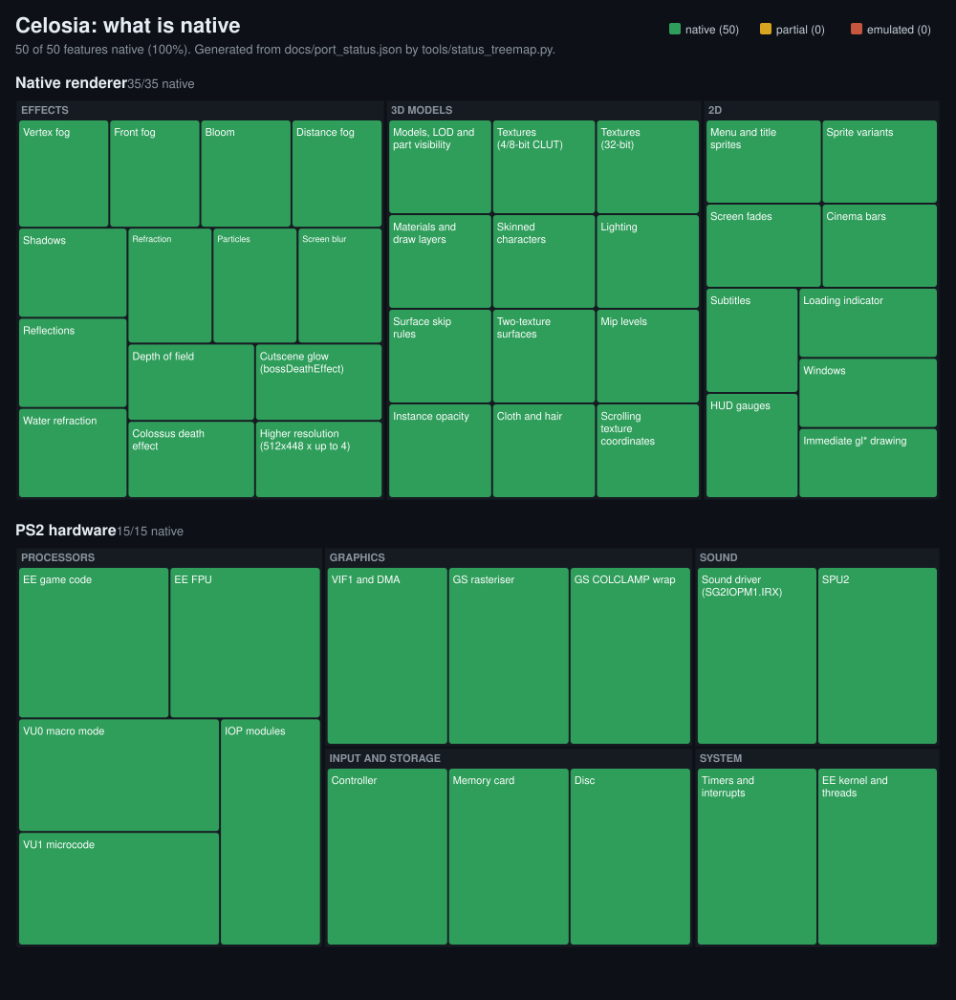

# Celosia: where the port stands

*Updated 2026-10-17.* Progress page (treemaps per area, decompilation,
history): [henrykun55.github.io/celosia](https://henrykun55.github.io/celosia/),
built from [`port_status.json`](port_status.json) and the decomp data next to it.

Celosia runs **Shadow of the Colossus** (PS2, USA, SCUS-97472) as native code
on macOS (Apple Silicon) and on the **PS Vita**. It began as a static
recompilation: the game's MIPS code turned into C++ with
[PS2Recomp](https://github.com/ran-j/PS2Recomp), running on a runtime that
emulated the PS2 hardware. Since then the hardware the game talks to has been
replaced, piece by piece, by native code. Today the game no longer needs a
GS, VU1 or VIF emulation to draw a frame. The next stage is decompiling the
game's own code where it matters.

## At a glance

| | macOS (Apple Silicon) | PS Vita |
| --- | --- | --- |
| Build | `./celosia setup` then `./celosia run` | `./celosia vita` → `.vpk` |
| Renderer | native, Metal (OpenGL kept as a check) | native, OpenGL ES (vitaGL) |
| Resolution | 512×448 × render scale (3 by default: 1536×1344) | 512×448 (scale 1) |
| Speed | 60 fps game / 60 fps display (M4 Pro) | 18–25 fps in Vita3K's intro; real hardware not measured yet |
| Audio | SPU2 reimplemented, IOP modules native | same |
| Saves | PCSX2-compatible `memcards/Mcd001.ps2` | `ux0:data/celosia/memcards/` |
| Playable | boot to gameplay (riding, exploring) | boots and plays the intro; fidelity and speed in progress |

Everything in [`port_status.json`](port_status.json) (50 features: 35 in the
renderer, 15 in the hardware) is **native**: no area still falls back to the
emulated path. `tools/status_treemap.py` redraws the picture above from it.

## What is native

**Graphics.** The game's model data is read straight from memory (modelDisp,
its LOD and part tables, materials and draw layers) and drawn by our own
renderer (`PS2Recomp/ps2xRuntime/src/lib/native/`):

- textures (4/8-bit CLUT and 32-bit), decoded once and cached by content;
- skinned characters, skinned on the CPU;
- lighting, two-texture surfaces;
- cloth and hair;
- shadow volumes;
- particles;
- all 2D (sprites, fades, cinema bars, subtitles, HUD, menus);
- GS vertex fog, the zFog into the sky;
- bloom, the boss-death glow;
- depth of field;
- screen blur;
- planar reflections, water refraction, heat haze.

[`native_renderer_map.md`](native_renderer_map.md) maps each effect to the
game function it replaces.

**Hardware.** EE timers, interrupts and DMA, the IOP modules (SIF, CD, pads,
memory card, sound) and the SPU2 run as host code from boot. The VU1
microcode was compiled ahead of time before the native renderer made it
unnecessary for drawing.

## Settings

Two menus show the same list of renderer settings
(`native_renderer::tuningItems()`), saved with the player settings
(`celosia_settings.cfg` next to the game on the Mac,
`ux0:data/celosia/settings.cfg` on the Vita); a `SOTC_*` variable set at
start wins over the saved value.

- **Player menu**: F1 on the Mac (fn+F1 on a Mac keyboard with media keys),
  Select twice on the Vita; Portuguese or English. Tabs: Video (exact
  transparency, show FPS, screen fit), Graphics (round 124: the preset and
  every item it sets, in groups), Frame rate, Debug (what is drawn, the
  layers), Sound, System, About. Each renderer tab ends with "Reset to
  defaults" (the High preset).
- **F10 panel** (Mac, ImGui): the same items in Quality (= Graphics) /
  Effects / Debug groups, the named values as lists; "Print to log" writes
  the current values as variables.

An item that does nothing on the renderer in use is still listed: its value
says "(Metal only)" / "(OpenGL only)" and its help starts with "No effect on
the ... renderer in use" (the F10 panel greys it).

### Graphics (round 124)

The preset row first (`gfx_preset`, `SOTC_PRESET=0..4`: Off, Low, Medium,
High, Max; "Custom" when any item below differs from all five), then the
items it sets under headings: Resolution & filtering, Lighting & post,
Shadows, Fog, Effects & particles, Distance & detail; last, the two
performance cuts no preset touches (camera checks, distant characters'
poses: they change timing, not just the picture) and "Max performance".
Every item applies at once (none needs a restart); each help line ends with
what it costs (GPU, render thread, game thread). High is each platform's
default look (new installs). A settings.cfg from before round 124
(settings_version < 39) keeps every item's value; its old quality_preset
(Low..Ultra) is not read. `SOTC_PRESET` at start wins over the saved values
of the preset items (each item's own variable wins over the preset).

| Item (key) | Off | Low | Medium | High | Max |
| --- | --- | --- | --- | --- | --- |
| Resolution (render_scale), Vita / Mac | 0.5x / 0.5x | 0.75x / 1x | 1x / 2x | 1x / 3x | 1.5x / 4x |
| Texture filtering (texture_filter) | nearest | bilinear | trilinear | trilinear | trilinear (Mac: anisotropic 16x) |
| MSAA, effect detail (Metal only; not listed on the Vita) | off, PS2 | off, PS2 | off, PS2 | off, PS2 | 4x, very high |
| Bloom (bloom; strength / blur / spread stay 1) | off | off | on | on | on |
| Glow (glow) / glow on the Vita (dbg_glow_vita) | off / plain | on / plain | on / plain | on / auto | on / auto |
| Depth of field (dof) | off | off | off | on | on |
| Screen blur (screen_blur), motion trail (feedback) | off | off | on | on | on |
| Shadows (shadows) / body shadows (body_shadows) | off / off | on / off | on / on | on / on | on / on |
| Distance fog (vertex_fog, amount 1) / depth fog (zfog) | off / off | on / on | on / on | on / on | on / on |
| Particles drawn (particles) | off | on | on | on | on |
| Fewer particles (sac_particles), Vita / Mac | on | on | on | on / off | off |
| Effects at half rate (sac_fx) | off | off | off | off | off (an item of its own: it measured slower in Vita3K) |
| Reflections (reflections) | off | off | on | on | on |
| Water refraction (refraction), heat haze (heat_haze) | off | off | off | on | on |
| GS alpha test (alpha_test) | off | on | on | on | on |
| Model detail (model_detail) | game's | game's | game's | game's | finest |
| Coarser detail (sac_lod), shorter draw distance (sac_drawdist) | on, on | on, on | on, off | off, off | off, off |

The heat haze item (new): the screen-copy draws (the shimmer behind the bird
colossus, some fights) left out; the underwater ripple (layer 19) stays
(`SOTC_NATIVE_NOHAZE=1`).

**Measuring.** A `[gfx124] frame F preset P key=value ...` line at start and
whenever any preset item changes (menu, F10, A/B); every `[frame]` line ends
with `| gfx <preset>` and `[stats]` has `gfx=<preset>`.
`SOTC_AB_FLAG=gfx124preset` (alone, no `SOTC_AB_ROTATE`) rotates the
presets Max, High, Medium, Low, Off, one every `SOTC_AB_PERIOD` frames
(`[gfx124ab]` lines; nothing saved). `build/agent-scratch/r124/gfx124.py
err.txt` splits a log by preset: frame / game / render p50 and p90.

### Renderer (effects)

Each strength multiplies the game's own, which it keeps changing per
scene and camera:

| Control | Default | Variable to set it at start |
| --- | --- | --- |
| Bloom on / strength | on / 1 | `SOTC_BLOOM_SCALE` (0 turns it off) |
| Bloom blur rounds / spread (OpenGL; Metal draws the GS chain at its fixed sizes, these only with `SOTC_BLOOM_OLD=1`) | 1 / 1.0 | `SOTC_BLOOM_ROUNDS`, `SOTC_BLOOM_SPREAD` |
| Vertex fog on / amount | on / 1 (the game's own; 0.55 before round 37) | `SOTC_NATIVE_NOVFOG=1`, `SOTC_FOG_AMOUNT` |
| Body shadows (Wander, Agro, colossi) | on (Mac and Vita since round 38) | `SOTC_BODY_SHADOWS=0/1` |
| GS alpha test (round 38: under-half-alpha pixels write no depth) | on | `SOTC_ALPHA_TEST=0/1` |
| Depth fog into the sky | on | `SOTC_NATIVE_ZFOG=0` |
| Glow, depth of field, shadows, particles, screen blur, motion trail, reflections, water refraction | on | `SOTC_NATIVE_NOGLOW`, `_NODOF`, `_NOSHADOWS`, `_NOPTCL`, `_NOSBLUR`, `_NOFEEDBACK`, `_NOREFLECT`, `_NOREFRACT` |
| Cap at 30 fps | off | `SOTC_CAP30=1` |

The Debug tab / group: show the native picture (F9), draw 2D / world,
textures, lighting, additive / subtract draws, second passes, raw mirror,
sky image, mipmaps, texture scrolling, frame timing log, fast hooks, PS2
lists, and the OpenGL-only heat haze / water sources, redraw for copies,
GPU skinning and render thread; then the 32 display-list layers.

`PS2X_TUNING_PANEL=1` opens the F10 panel at start (`PS2X_SETTINGS_OPEN=<tab>` the
player menu). `SOTC_QUALITY_CYCLE=N` (development) steps through the presets and single
quality options every N frames, logging `[quality]` lines, to compare them
on one scene. On the Vita, `ux0:data/celosia/env.txt` holds `NAME=value`
lines (the Vita has no environment).

Renderer selection: `SOTC_NATIVE=1` draws natively (the default),
`SOTC_NATIVE=2` draws natively without showing it (side-by-side checks),
`SOTC_NATIVE_GL=1` uses the OpenGL renderer on the Mac and `=check` compares
it against Metal every second.

## How the recompilation was done

1. **Boot ELF.** Function starts are recovered from symbols, JAL targets,
   code pointers and prologues (`tools/funcmap_elf.py`). Names come from
   KERNEL.XFF's imports.
2. **Modules.** The game links `KERNEL.XFF`, `MANAGER.XFF` and
   `GAMECORE.XFF` in memory with its own dynamic linker. Each is captured
   from RAM the moment the game jumps into it, then cut out at its final
   addresses (`tools/modimage.py`).
3. **Link.** `tools/build_elf.py` merges everything into one `SOTC.elf` plus
   a function map (~9 000 functions) and the list of instructions the
   guest linker rewrites. Since 2026-10-19 the heuristics' false starts
   are merged back (`merge_split_starts`): a start inside a module
   symbol's size, or one a branch crosses, is a switch case, an aligned
   label or a prologue-like store in the middle of a body (7 251 of the
   16 274; GetLayoutClass was cut in 7, iosDlPushLayer in 2). Split, the
   jumps between the pieces left the function at run time (3M nested host
   calls a second on the Mac); whole, they are gotos.
4. **Config.** `tools/gen_config.py` writes the recompiler config:
   - stubs for the SDK calls the runtime implements;
   - since 2026-10-17, **hidden entry points**: 841 pieces of code packed
     right after another function's jump, which the game calls through
     pointers. One of them, a three-instruction leaf at 0x1357888, froze the
     game about 14 minutes in. The merged starts are entry points too,
     so whatever reached them before still does.
5. **Recompile** to C++ and build. The VU1 microcode was compiled the same
   way.

Details: [README](../README.md#how-it-works).

## Decompilation, the next stage

The recompiled C++ works but cannot be read or changed. The plan is a
*functional* decompilation: rewrite, by hand and in readable C++, the
functions that matter for speed or for the Vita. Each one goes in only when
it is proven equal to the recompiled one. A matching decomp, rebuilding the
PS2 binary, is not the goal.

The loop:
1. A guest profiler finds the hot functions (`PS2X_PROFILE`).
2. Ghidra reads them (`tools/ghidra.sh`).
3. The rewrite is registered with `SOTC_DECOMP_FUNCTION`.
4. `SOTC_DIFFTEST` runs native and recompiled code on the same state and
   compares every register and every byte of RAM.

Done so far: the SDK's software doubles (dpadd, dpmul, dpdiv…): ~93 000
checks, 0 mismatches. They turned out to truncate instead of rounding, which
an IEEE rewrite got wrong.

Next candidates:
- the display lists the game still builds for models the native renderer
  draws itself (~6%);
- collision;
- the model display path.

Guide: [`decomp.md`](decomp.md).

## Latest changes (2026-10-16 → 17)

- **Higher resolution.** The native picture is drawn at 512×448 × a render
  scale (3 on the Mac) and shown at that size, filtered. It used to go
  through the emulated display and be point-sampled down to 512×448, which
  made edges, hair and cloth look broken.
- **F10 tuning panel** for the renderer's effects, and the defaults set by
  eye against the PS2 picture.
- **Vita:**
  - native renderer on vitaGL;
  - per-frame geometry in one buffer per frame (8–16 → 18–25 fps in Vita3K);
  - uniform lookups cached;
  - fog by depth without depth textures.
- **Long-run stability:**
  - the game's freeze ~14 min in (hidden entry points, above);
  - meshes and textures nobody drew for 30 s are released (content-hashed
    ids filled the Vita's 160 MB in 12 min);
  - the VU1 worker queue is bounded (it grew by 40–90 MB in heavy scenes);
  - a per-frame log line that wrote ~100 000 lines a run is gone.

## Open issues

- **Bloom shape.** Bright openings, like the shrine's window, saturate to a
  flat white with a narrow halo. The PS2 shows a wide, soft glow with the
  landscape visible through it.
- **Character meshes.** Gaps are still reported on Wander and other animated
  models. Skinning weights and strip assembly were checked and are correct;
  under investigation.
- **Vita:**
  - bloom and glow are off (no depth textures);
  - speed on real hardware is not measured yet.
- **Long runs on the Vita** need a confirmation run past 80 minutes with the
  bounded VU1 queue.
- [`worklist.md`](worklist.md) is the ordered list of what is being fixed now.
- [`known_issues.md`](known_issues.md) has the older ones (the raised-sword
  arm swing, the earlier brightness study).

A note for fidelity work: the emulated picture's GPU rasterizer has no GS
fog. Compare the native picture against `PS2X_GS_GPU=0` (CPU raster, exact
GS fog), not against the default emulated view.

## R36S (Linux aarch64) — status recorded 2026-11-08

### Objective

Port recompilation of **Shadow of the Colossus (USA SCUS-97472)** via
PS2Recomp/Celosia to **R36S (aarch64, SDL2/KMSDRM + GLES)** so the game boots
and runs playable, with no x86 CPU emulation.

### Current state (measured, 08/11/2026)

All values below were measured in this session; none are estimated. The
working build is 51.350.952 B, md5 `d9a17982dc91bcefb1beb895c27521b6`, run
as `SCUS_974.72` (copy of `NICO.ELF`) so that the overrides apply.

| Metric | Measured value | Source |
|---|---|---|
| `gameFps` (EE) | 60 | `[stats]` / `enableHostClockSync()` fix (sotc_overrides.cpp:941) |
| `hostFps` (real `SDL_GL_SwapWindow` swaps) | ≈57–60 | `ps2_runtime.cpp:3450-3452` (new metric) |
| idle spin | eliminated (35k/s → ~445/s) | after fix 1 |
| `mscal` / `vu1Instr` / `xgkick` | 0 / 0 / 0 | 14 samples (A2) + 35 samples (A3) |
| triangles | **0** always | all runs |
| lines / sprites | ~1900/frame / ~120/frame | all runs → loading screen |
| `ps2sotc_aarch64_pie_sdl` | 51.350.952 B, md5 `d9a17982dc91bcefb1beb895c27521b6` | current build |
| run-as name | `SCUS_974.72` (copy of `NICO.ELF`) | overrides apply |
| GS buffers (PPMs 640×512) | 20.640 / 81.965 / 20.570 non-black pixels, bbox `x=8..639, y=192..447` and `x=3..639, y=196..511` | `PS2X_DUMP_GS_BUFFERS` |
| `/dev/fb0` | 100% black (1.228.800 bytes zero) | measured |
| `ExportImage` / `PS2X_SNAPSHOT_DIR` | stub on Linux (`raylib_linux.cpp:894`) → only `index.txt` | measured |
| `[sotc] GAMECORE entered` | **never** appears | `sotc_overrides.cpp:67-68` |
| `[ee:sema] signal` | exactly **one** in the whole log (`gid=6 cnt=0 waiters=1`, mx_A.log:10509) | measured |
| `[syscall]` after boot | **none** (33 lines total, all before `[ld:enter]`) | `PS2X_TRACE_SYSCALLS=1` trace |

Corrections vs. the previous revision (marked): the statement that "0x0d/0x0e
are the bottleneck" is **corrected** — they were probed at boot only and are
not the stall cause (see H3). The statement that "input does not reach the
game" is **corrected/refined** — input reaches libpad (`[pad2] input
buttons=`) but the guest ring buffer in 0x118d680 is never written (see H4). The statement that the stall is a post-JALR semaphore deadlock (gid=14), and that `PS2X_GS_NODRAW=0` is mandatory with `SOTC_NATIVE=1`, is **corrected** (2026-11-09 — ver « Sessão 2026-11-09 », itens A e C).

#### Matriz A/B/C (3 runs × 70 s, RAM dump at t=35 s)

RAM dump block 0x118d680 (2×0xF98) was **100% zero** in all three runs
(`head=0x118d638`=0, `count=0x118d63c`=0, 30 ring samples `0x00000000`,
cur/pressed/released/any=0, analog `00 00 00 00`).

| Run | Env | Result |
|---|---|---|
| A | `SOTC_NATIVE=1 PS2X_NATIVE_IOP_BOOT=0 PS2X_NATIVE_IOP=0` (emulated IOP, dropped=0) | pad block 100% zero |
| B | `SOTC_NATIVE=2` (native IOP, dropped=2) | pad block 100% zero |
| C | `SOTC_NATIVE=0` (emulated) | pad block 100% zero |

Input injection works at libpad level: `[pad2] input buttons=0xfff7` (START),
`0xbfff` (CROSS), `0xffbf` (DOWN). The stall is worse without input (run A3
without input: t=60→151, 91 s at 2.3 fps, `gsWait(space 417.1)`); the
primitive explosion (ln 1952→16160, sprite 123→1010 in A; 38720/2419 in A3)
does **not** depend on input — it is the loading-screen redraw.

#### Boot chain confirmed (all measured)

- Loader reaches GAMECORE entry: `[ee:th] printf id=6 text=ld: output linker
  script .cdrom0:\GAMECORE.XFF;1.cmd.` + `[vfs:open]
  path="cdrom0:\GAMECORE.XFF;1.cmd" flags=0x602 -> fd=12` (mx_A.log:974/976)
  + `[guest-branch:containing-function] source=0x1b5bcc target=0x1344788
  kind=IndirectCall name=JALR` (mx_A.log:980).
- `sceCdSearchFile` works host-side: `\MANAGER.XFF;1` → lsn `0x100000`, size
  `0x1930bc`, 0x327 sectors; `\GAMECORE.XFF;1` → lsn `0x100328`, size
  `0x20aea8`, 0x416 sectors.
- The `cdrom0:` tree is served host-side from the VFS `cdRoot` =
  `elfDirectory` (`ps2_runtime.cpp:1452-1454`, `ps2_vfs.cpp:366`). The file
  is opened via `fioOpen`/`fioRead` (`Kernel/Syscalls/FileIO.cpp:77,160`),
  never via `sceCdRead` (0 post-boot calls) nor logged `vfs:read`.
- `[sotc] GAMECORE entered` (`sotc_overrides.cpp:67-68`) **never** appears.

#### Semaphore deadlock — central finding (measured) — **corrigido (2026-11-09, item A)**

> **Corrigido (2026-11-09):** `gid=14` (`sceMc2Init`, global em `rdram+0x151E24`, 5 funções `sceMc2*Async`) e `gid=3` (`PreparePowerOff`, `rdram+0x13A118`) são workers ociosos — threads 7 e 2, comportamento normal, **não** deadlock. Ver « Sessão 2026-11-09 », item A.

- 16 semaphores created (gid 1..16); gid=14 and gid=15 with init count **0**,
  max 127.
- Exactly **one** `signal` in the whole log: `[ee:sema] signal gid=6 cnt=0
  waiters=1` (mx_A.log:10509).
- Loader thread id=6 (entry `0x1b34a0`) waits on gid=7 and gid=9, never woken.
- Game threads id=1 (`entry=0x100010`, `pc=0x103ab0`), id=2 (`entry=0x104ff0`,
  `pc=0x105018`, `waitId=3`) and id=7 (`entry=0x11b458`, `pc=0x11b488`,
  waits gid=14 with cnt=0) sleep forever.
- Kernel thread id=5 stays `RUNNING` in the idle loop (`pc=0x1b11a8`).
- No new syscalls during the stall (trace empty after line 209).

#### VU1 / GS (measured)

- VU1 **never** executes in any sample (`mscal=0`, `vu1Instr=0`, `xgkick=0`
  in all 14 samples of A2 and 35 of A3).
- Triangles **0** always; only lines (~1900/frame) and sprites (~120/frame) —
  the loading screen.
- The GS **draws real content** that does not reach the screen:
  `PS2X_DUMP_GS_BUFFERS` (PPMs 640×512) → 20.640 / 81.965 / 20.570 non-black
  pixels, bbox `x=8..639, y=192..447` and `x=3..639, y=196..511`;
  `/dev/fb0` is 100% black (1.228.800 bytes zero) and `ExportImage` is a
  stub on Linux (`raylib_linux.cpp:894`) → `PS2X_SNAPSHOT_DIR` writes only
  `index.txt`.

#### Memory / cards (measured)

- `memcards/`, `mc0/`, `mc1/` empty; the runtime creates a blank
  `Mcd001.ps2` (0xFF) accepted as valid (`MemoryCard2.cpp:116-123`);
  `CheckNewCard` does not block.
- `MC2_D` loaded; `MCMAN`/`MCSERV` (MODULES2/) never loaded.
- `tools/native_run.sh` requires `memcards/Mcd001.ps2`.

### Environment (device facts)

- Device **R36S (Debian 13 aarch64, 192.168.2.121, `ark/ark`)**, WSL Ubuntu +
  `sshpass`; ES restored after each run (verified PID + fd card0). `/tmp` =
  tmpfs 448M.
- Game dir `/roms/ports/SotC_Celosia/`: `NICO.DAT` 2.667.340.678 B (NOT
  ISO9660 — custom header, no `CD001`), `NICO.ELF` 242.940 B,
  `GAMECORE.XFF` 2.141.864, `MANAGER.XFF` 1.650.876, `KERNEL.XFF` 415.908,
  `STARTUP.XFF` 26, `SYSTEM.CNF` 57, `IOPRP300.IMG` 275.345, `MODULES/`
  (SIO2MAN, DBCMAN, SIO2D, DS1O_D, USBD, PL2303, LIBSD, MC2_D, SG2IOPM1),
  `MODULES2/` (MCMAN, MCSERV), plus the **linker scripts**
  `GAMECORE.XFF;1.cmd` 77.395 B, `MANAGER.XFF;1.cmd` 14.366 B,
  `KERNEL.XFF;1.cmd` 127 B (the game's symbol maps; e.g. `FlushPadHistory =
  0x114b0a8`, `padSysGet` = `0x104e78` — they resolve guest addresses without
  the upstream `functions.csv`).
- Binary `ps2sotc_aarch64_pie_sdl`, 51.350.952 B, md5
  `d9a17982dc91bcefb1beb895c27521b6`; must run as `SCUS_974.72` (copy of
  `NICO.ELF`) for the overrides to apply.
- Build: `ninja -C build/linux-aarch64
  -j4 ps2EntryRunner`, LTO off, sysroot `$SYSROOT`.
- **FORBIDDEN** on the device: `ls /proc/[0-9]*/fd/*` (froze the R36S once),
  `ffmpeg -f fbdev`, `ffmpeg -f kmsgrab`, `pkill` outside the atomic script.
  See `docs/r36s_port.md` (h) and `tools/r36s_smoke.sh` (header).

### Infrastructure

- Device: **ark@192.168.2.121** (Debian 13 aarch64, EmulationStation).
- Binary: `build/linux-aarch64/ps2xRuntime/ps2EntryRunner`
  → `/roms/ports/SotC_Celosia/ps2sotc_aarch64_pie_sdl`; **51,350,952 bytes,
  MD5 `d9a17982dc91bcefb1beb895c27521b6`** (current build).
- Runs as **`SCUS_974.72`** (copy of `NICO.ELF`; symlink blocked by the
  sandbox). Running as `SCUS_974.72` **activates the overrides**
  (`[ovr] match check ... matched`).
- Run environment: `PS2X_GS_NODRAW=0` (see fix 3) and, for captures,
  `PS2X_CAPTURE_DUMP=/tmp/cap:0` (dumps GS frame PPMs, up to 24,
  `cap_%06llu.ppm`).
- `/tmp` is a 448M tmpfs (clean after each run). **Never** use `pkill` on ES
  outside the atomic script (the script already restores it).
- `/dev/fb0` exists on the device; `ffmpeg` at `/usr/bin/ffmpeg`;
  `kmsprint`/`fbgrab` absent.
- ⚠️ **NIM 02 account rate-limited** (`free-models-per-day`) — for device
  execution, use `or-roterista` (OpenRouter free).

### Fixes applied (code)

1. **`game\overrides\sotc_overrides.cpp:941`** —
   `runtime.eeScheduler().enableHostClockSync()` unconditionally in
   `applySotcOverrides` (commit `dd53b12`). Effect: `idleWait()` blocks when
   there is no work → `gameFps=60`, idle spin eliminated (35k/s → ~445/s).
   Root cause: `enableHostClockSync()` was only called in
   `gamecoreEntryHook` (which never fires because boot stops at GAMECORE's
   linker script).
2. **`PS2Recomp\ps2xRuntime\src\lib\ps2_runtime.cpp:3450-3452`** — new
   `hostFps=` metric (real `SDL_GL_SwapWindow` swaps, `hostFps≈57–60` real;
   before, `shownFps` measured only async GS captures `presentedFrames`).
3. **`PS2Recomp\ps2xRuntime\CMakeLists.txt`** — includes
   `game/overrides/*.cpp` in non-Vita builds (commit `5380723`).
4. **`game\overrides\decomp_lines67.cpp`** — `#if defined(__APPLE__)` around
   `mach-o/dyld.h` (commit `5380723`).
5. **Environment `PS2X_GS_NODRAW=0` is mandatory with `SOTC_NATIVE=1`** —
   without it, `skipRaster()` returns true (because `SOTC_NATIVE=1` enables
   `native_renderer::shown()`) and **no** drawing happens. **corrigido (2026-11-09, item C):** só vale com `shown()==true`; no R36S atual `shown()==false`, logo `skipRaster()` é false, o desenho continua, e `PS2X_GS_NODRAW=1` não alivia o stall.
6. **Input injection works** in libpad: `[pad2] input buttons=0xfff7`
   (START), `0xbfff` (CROSS), `0xffbf` (DOWN).

### Key diagnostics (recorded)

- `skipRaster()` (`gs_frontend.cpp:826-832`): with `SOTC_NATIVE=1` and
  without `PS2X_GS_NODRAW=0`, `m_backend->SubmitVuBatch` is never called →
  0 draws.

  **corrigido/refinado (2026-11-09, item C):** o « 0 draws » só vale com `shown()==true`; com `shown()==false` (caso atual) `skipRaster()` é false, `SubmitVuBatch` **é** chamado (gs_frontend.cpp:818) e os uploads seguem (gs_frontend.cpp:1937).
- `shownFps` ≠ real swaps: `ps2_runtime.cpp:3450` measures
  `ps2_stats::presentedFrames/5` (incremented only in
  `gs_async_backend.cpp:263`), while `SDL_GL_SwapWindow` is called **every
  iteration** (`raylib_linux.cpp:676` via `ps2_runtime.cpp:3785`) and is
  measured as `hostFps` (~59).
- `native_renderer` on Linux: `SOTC_NATIVE_GL=1` activates the GL backend
  (`wantGl()` in `native_renderer.cpp:1047-1054`), but the code
  (`native_renderer_gl.cpp:78`) uses `#version 330 core` with a GLES3 header
  → **incompatible with SDL2's GLES3 context**; no `makeCurrent` via
  `SDL_GL_*`.
- VU1 never runs: `ps2_memory.cpp:287-289` creates the VU1 thread lazily and
  waits on `m_mtvuWork.wait` (line 317), woken by `notify_one` (line 300)
  only via `mtvuEnqueue`; `execute(startPC)` is never called (no MSCAL from
  VIF and no XGKICK, `xgkick=0` in the stats).
- Native IOP: `sg2iop_driver` is replaced by the native driver
  (`iop_emulator.cpp:772`); `CDREAD`/`CDROM`/`FILEIO` **absent**; RPCs to SIDs
  without HLE are "dropped" (completed without data) in
  `iop_subsystem.cpp:254`.
- `sceCdRead` (`CD.cpp:573-707`): unresolvable LBN → `memset` + `return 0`
  (line 681/706). `sceCdSync(0)` blocks via `waitExternal` (`CD.cpp:725`)
  until the worker's `ExternalWake` (line 436). `sceCdGetInfo`/`sceCdGetType`/
  `sceCdReadParam` **absent**.
- **Correção (H3):** EE syscalls 0x0d/0x0e are **not** the bottleneck. Trace
  with `PS2X_TRACE_SYSCALLS=1` (`ps2_runtime.cpp:2104`): only 33 `[syscall]`
  lines in the whole log (1.065.761 B / 35.028 lines), all before `[ld:enter]`
  (lines 27–208). IDs: `0x74` (10, SetSyscall), `0xe` (9), `0x5b` (6,
  GetEntryAddress), `0xd` (3), `0x83` (2, FindAddress), `0x3c`, `0x3d`, `0x5a`.
  **No syscall is traced during the stall.** The `v1=0xd` calls (PC=0x106c98,
  RA=0x10f330, a0=1,2,3) and `v1=0xe` calls (PC=0x106ca8, RA=0x10f348,
  a0=4,5,6,7,9,a,b,c,d) are the **kernel syscall-table enumeration at boot**
  (`SetSyscall`/`GetEntryAddress` in sequence) — then boot continues. For the
  upstream, the IOP is also native (`tools/native_run.sh:24` uses
  `SOTC_NATIVE=2`), and the game works there — so 0x0d/0x0e are not the
  blocker.
- The `Dispatcher.cpp` has no `case` 0x07–0x0f, and the 37 `sceCd*` stubs of
  `CD.cpp` have **no call site** (grep over the whole repo = 0 outside
  `CD.cpp`/`CD.h` and one test) → dead code.
- `PS2X_NATIVE_IOP=0` alone does **not** prevent native boot
  (`iop_subsystem.cpp:22-28` `nativeIopBoot()` uses `PS2X_NATIVE_IOP_BOOT`
  with fallback to `SOTC_NATIVE`; `:30-36` `nativeIopAllowed()` uses
  `PS2X_NATIVE_IOP` and only blocks the **runtime transition** via
  `enterNativeMode()`). With `PS2X_NATIVE_IOP_BOOT=0` the IOP boots emulated
  (dropped=0) — but the game does not advance either.
- **Correção (H4):** input **does** reach libpad (`[pad2] input buttons=`)
  but the guest ring at 0x118d680 is never written (the guest pad thread
  `padSysGet` is called 4.694×, but the block stays zero).

### Root causes confirmed / hypotheses

- **Confirmed via the user and via GS dumps**: the screen (GS buffers) shows
  real content (20.640 / 81.965 / 20.570 non-black pixels, bbox
  `x=8..639, y=192..447` and `x=3..639, y=196..511`) → GS rasterization
  **works** (that is the `ln`+sprites). `/dev/fb0` is black because
  presentation to the framebuffer does not happen on this path
  (`displayFbp=0`, `sourceFbp=224`; item 50).
- **H1 — "Native IOP drops pad RPCs (0x8000131e/f) → zeroed pad block → game
  does not advance": REFUTED.** Matrix of 3 runs × 70 s with RAM dump at
  t=35 s: A (`SOTC_NATIVE=1 PS2X_NATIVE_IOP_BOOT=0 PS2X_NATIVE_IOP=0` →
  emulated IOP, dropped=0), B (`SOTC_NATIVE=2` → native, dropped=2),
  C (`SOTC_NATIVE=0` → emulated): in all 3 the block 0x118d680 (2×0xF98) was
  **100% zero** (`head=0x118d638`=0, `count=0x118d63c`=0, 30 samples of the
  ring `0x00000000`, cur/pressed/released/any=0, analog `00 00 00 00`). That
  is, with **emulated** IOP the pad was still invisible to the game.
- **H2 — "missing `.cmd` files (linker scripts)": REFUTED.** They exist:
  `GAMECORE.XFF;1.cmd` 77.395 B, `MANAGER.XFF;1.cmd` 14.366 B,
  `KERNEL.XFF;1.cmd` 127 B in `/roms/ports/SotC_Celosia/`, and runs after
  their creation (11:07) stay stuck the same way.
- **H3 — "EE syscalls 0x0d/0x0e are the bottleneck": REFUTED as direct
  cause.** Trace `PS2X_TRACE_SYSCALLS=1` (`ps2_runtime.cpp:2104`): 33 lines
  `[syscall]` in the whole log (1.065.761 B / 35.028 lines), all before
  `[ld:enter]` (lines 27–208). IDs `0x74` (10, SetSyscall), `0xe` (9),
  `0x5b` (6, GetEntryAddress), `0xd` (3), `0x83` (2, FindAddress), `0x3c`,
  `0x3d`, `0x5a`. **No syscall traced during the stall.** `v1=0xd`
  (PC=0x106c98, RA=0x10f330, a0=1,2,3) and `v1=0xe` (PC=0x106ca8,
  RA=0x10f348, a0=4,5,6,7,9,a,b,c,d) are the **kernel syscall-table
  enumeration at boot**; boot then continues. `Dispatcher.cpp` has no `case`
  0x07–0x0f; the 37 `sceCd*` stubs of `CD.cpp` have **no call site** (whole-
  repo grep = 0 outside `CD.cpp`/`CD.h` and one test) → dead code. For the
  upstream, **the IOP is also native** (`tools/native_run.sh:24` uses
  `SOTC_NATIVE=2`), and the game works there — so 0x0d/0x0e are not the
  blocker.
- **H4 — "input does not reach the game": partially refuted** — it reaches
  libpad (`[pad2] input buttons=`) but the guest ring at 0x118d680 is never
  written (guest pad thread `padSysGet` called 4.694×, block stays zero).
  The stall is worse **without** input (run A3 without input: t=60→151,
  91 s at 2.3 fps, `gsWait(space 417.1)`), so the primitive explosion
  (ln 1952→16160, sprite 123→1010 in A; 38720/2419 in A3) **does not depend
  on input** — it is the loading-screen redraw.
- **Central finding (corrigido 2026-11-09, item A): post-JALR semaphore deadlock — a leitura de gid=14/gid=3 como causa foi refutada (são workers ociosos; ver « Sessão 2026-11-09 », item A).** 16
  semaphores created (gid 1..16; gid=14 and gid=15 with init count **0**,
  max 127) and at least **one** `signal` in the whole log
  (`[ee:sema] signal gid=6 cnt=0 waiters=1`, mx_A.log:10509). Loader thread
  id=6 (entry `0x1b34a0`) waits on gid=7 and gid=9 and is never woken; game
  threads id=1 (`entry=0x100010`, `pc=0x103ab0`), id=2 (`entry=0x104ff0`,
  `pc=0x105018`, `waitId=3`) and id=7 (`entry=0x11b458`, `pc=0x11b488`,
  waits gid=14 with cnt=0) sleep forever; kernel thread id=5 stays `RUNNING`
  in the idle loop (`pc=0x1b11a8`). `[sotc] GAMECORE entered`
  (`sotc_overrides.cpp:67-68`) **never** appears. No new syscall during the
  stall (trace empty after line 209).
- `mscal=0`/`vu1Instr=0` = effect of the game not having reached 3D geometry
  (not a cause).
- `displayFbp=0` + black `/dev/fb0` = presentation gap (loading screen
  probably on FBP 224, or the upload does not mirror into what the dump
  reads). **refinado (2026-11-09, item C):** sem `sceGsResetGraph` do guest o display env nunca é programado (`Kernel/Stubs/GS.cpp:786` -> `gs_cpu_backend.cpp:3613-3617`), logo `Present` não recebe request válido e a imagem nunca chega ao swap (uploads continuam).

### Next steps (ordered)

1. **Diff with the upstream**: `git diff origin/main..HEAD` = 20 files /
   +2.418 (the whole Linux layer is local) — compare and decide what is
   missing (worklist item 36).
2. **Semaphore residuals (gid=9) — corrigido (2026-11-09, item A):** gid=14/gid=3 sao workers ociosos, nao deadlock; quem deve sinalizar gid=9
   (thread 1? loader id=6? an interrupt handler?). Use `PS2X_TRACE_SCHED`
   (`EeScheduler.cpp:2138`) and `[ee:sema]` to instrument; resolve PCs
   0x103ab0/0x105018/0x11b488/0x1344788 via `tools/guest_profile.py` (needs
   `recomp/game/functions.csv` ← `tools/funcmap_elf.py` ←
   `docs/scus_symbols.txt` ← `tools/xff.py` over the disk; fallback: the
   `.cmd` symbol maps).
3. **CD/IOP path**: how the upstream reads the disk with native IOP and
   without `CDROM.IRX`/`FILEIO.IRX` (absent in the emulated IOP; no code
   loads `IOPRP300.IMG`); confirm whether the `fioRead` of the `.cmd`
   (fd=12) returns the 77.395 bytes (no `vfs:read` in the log).
4. **Pad**: find who writes the 30-sample ring at 0x118d680 (the guest pad
   thread; `decomp_padhist.cpp:5-16` describes the format) and why it never
   writes.
5. **VU1** after loading advances (item 35).
6. **GS→GLES presentation** (`displayFbp=0`, `sourceFbp=224`) and the
   screenshot path on Linux (item 32).
7. **Memory card**: generate an `Mcd001.ps2` with a save to unlock the
   gameplay route (item in `native_run.sh`).

### Session log (2026-11-08, continued)

- 4 new commits on top of `c9216ae` (build verified, md5
  `d9a17982dc91bcefb1beb895c27521b6`):
  - `a02ac0d` chore(r36s): normalize whitespace / line endings of the working
    tree.
  - `5380723` build(r36s): include `game/overrides` in non-Vita builds and
    port `dyld.h` for `dladdr`.
  - `11a9b6d` runtime(r36s): real `hostFps` metric and EE/overrides diagnostic
    instrumentation.
  - `dd53b12` overrides(sotc): `enableHostClockSync` unconditional in
    `applySotcOverrides`.
- Build command:
  `ninja -C build/linux-aarch64 -j4 ps2EntryRunner`
  (LTO off, sysroot `$SYSROOT`).
- Matrix A/B/C (3 × 70 s, RAM dump at t=35 s), syscall trace
  (`PS2X_TRACE_SYSCALLS=1`, 33 `[syscall]` lines), semaphore deadlock
  (gid 1..16; gid=14/15 init 0; single signal `gid=6`), GS-buffer PPMs
  (20.640 / 81.965 / 20.570 non-black pixels), pad ring at 0x118d680
  100% zero in all runs.
- Smoke test made repeatable: `tools/r36s_smoke.sh` (see docs/r36s_port.md).

### Sessão 2026-11-09 — semáforos ociosos, baseline do run e caminho de apresentação

Medido em 09/11/2026, sobre a seção R36S acima. As linhas de código citadas foram
reconferidas nesta sessão. Onde a revisão anterior estava factualmente errada, o
texto original foi preservado e marcado como **corrigido**.

#### A) Semáforos ociosos — hipóteses refutadas

- `gid=14` **não** é deadlock: é criado por `sceMc2Init` (`0x11a208/0x11a22c/0x11a250`, cria gid13/14/15); o global fica em `rdram+0x151E24` e é sinalizado por 5 funções `sceMc2*Async`. A thread 7 é o worker MC2 ocioso — comportamento normal.
- `gid=3` **não** é o bloqueio: pertence a `PreparePowerOff` (global `rdram+0x13A118`); a thread 2 é worker de power-off ocioso.
- Refutadas também: IOP nativo sinalizando gid=14; falta de `.cmd`; syscalls 0x0d/0x0e como gargalo; `PS2X_GS_NODRAW=1` aliviando o stall (ver item C); redirect do entry do GAMECORE alterando o resultado (ver item D).

#### B) Baseline do run (150 s)

- 98% do log é churn de scheduler; só a thread 5 (`iosRecvMsg`, `pc=0x1b11a8`) acorda a ~32 Hz.
- `sceCdRead=0` e `sceCdSync=0` no run inteiro; apenas 2 `sceCdSearchFile` OK: `MANAGER.XFF` e `GAMECORE.XFF`.
- 128 uploads (`frame:upload`) sem wrap.
- Imagens do device idênticas às do host (md5): `GAMECORE.XFF 4c297ea0…`, `MANAGER.XFF fe2252e5…`, `KERNEL.XFF 607aa94a…`, `NICO.ELF 0c08d02e…` -> sem mismatch de versão.
- Threads ao fim: tid1 `0x103ab0` (sleep), tid2 `waitId=3`, tid5 RUNNING `0x1b11a8`, tid7 `waitId=14`, tid4/8/9/10 dormindo.

#### C) Caminho de apresentação (código, arquivo:linha reconferidos)

- Não existe `GS::Present` em `platform/linux/raylib_linux.cpp`. O swap real é `EndDrawing()` -> `SDL_GL_SwapWindow` (`raylib_linux.cpp:673-676`), e o desenho de textura GL nativa é `DrawTexturePro` (`:703-718`).
- O loop principal (`src/main.cpp`, `PS2Recomp/ps2xRuntime/src/main.cpp`) **não** chama `BeginDrawing`/`EndDrawing`/`DrawTexturePro`; o present do renderer nativo vem de `native_renderer_gl.cpp`: `endFrame()` (`:7010`) -> `presentPending` (`:6766-6769`) -> `presentNow()` (`:4485`).
- `PS2X_GS_NODRAW` suprime raster/VU1; o upload também é suprimido **quando** `skipRaster()` é true **e** `m_trxdir != 1` (`gs_frontend.cpp:1936-1937`). No estado atual `native_renderer::shown()` é false → `skipRaster()` é false → os uploads continuam. `GS::skipRaster()` (`gs_frontend.cpp:826-832`, comentário `:822-825`) retorna `noDraw != 0 && native_renderer::shown()`; em `:818` `if (!skipRaster()) m_backend->SubmitVuBatch(*batch)` -> explica por que `PS2X_GS_NODRAW=1` não aliviou o stall.
- Ring de frames é 8 (`native_renderer_gl.cpp:213-214` `kFrames = 8`, `:269` `g_frames[g_presents % kFrames]`) — o « 128 » **não** é índice de ring; o valor 128 aparece em `:290` como delta de cena (`b.last - a.last < 128u`). « Estagnação do idx em 127 » é hipótese, não fato de código.
- Nenhum `#ifdef`/`getenv("DISPLAY")`/`getenv("RENDERER")` desativa o present no Linux/aarch64; o único `#ifdef` em `gs_cpu_backend.cpp:3601` `Present()` é `__vita__` (`:3607-3612`).
- Ligação GS->present: `sceGsResetGraph` (`Kernel/Stubs/GS.cpp:786`, pacote GIF com PMODE/SMODE2/DISPFB/DISPLAY/BGCOLOR em `:805-841`) -> `gs_cpu_backend.cpp:3613-3617` (`dispfb1`/`display1`, `decodeDisplaySize`). **Sem `sceGsResetGraph` do guest, o display env nunca é programado e `Present` não recebe request válido** — uploads continuam, imagem nunca chega ao swap. (Outros stubs: `sceGsSetDefDispEnv` `:999`, `sceGsSyncV` `:1281`.)

#### D) Experimento de entry do GAMECORE (refutado)

- `SOTC_GAMECORE_ENTRY` é opt-in, default desligado; commits `1fc8703` (hook em `0x01344780`) e `4502ab1` (experimento).
- Rodadas E1 (`->0x13447c8`) e E2 (`->0x1344708`) produziram estado final idêntico ao controle F3: mesmos 10 `vfs:open`, 128 uploads, `mscal=0`, `sceCdRead=0`; thread 6 termina com `pc=0x3196860` (endereço inválido, > 32 MB).
- Após o JALR do loader (`source=0x1b5bcc -> target=0x1344788`) nenhum evento novo do guest (sem `vfs:open`, `printf`, `ios:*`, `guest-branch`); sem `sceGsResetGraph`/`scePadInit` em 150 s; VU1 parado; `shownFps≈0`.
- `0x1344788` cai no meio de `gamecore_sub_01344708` (`jal GAMEUTIL_get_node_posi_by_id`); o init aparente é `0x13447C8` (`init gc/initgcmain/initgcmaingp/initgcchartest`). Entry vem de `lw 0x1C($s1)` -> `lw 0x10($v0)` -> `jalr` em `IosCdvdManagerSimulation_0x1b5a00`.
- **Refutado (2026-11-09):** não existe deslocamento de base de 0x40. Os encodings do recompilado (`jal 0x0C41FDC8` em `0x1344788`, `jal 0x0C4D16EC` em `0x13447D0`, `lui 0x3C020146` em `0x134470C`) não ocorrem em nenhum byte de `build/watch/GAMECORE.XFF` em LE nem BE — mas isso **não** indica build diferente: o `.text` do XFF é relocável (6 tabelas de relocação, ~39 mil entradas, `R_MIPS_26` para os `jal`), logo o alvo absoluto não é armazenado literalmente. O container `xff2` **não é comprimido** (varredura completa: nenhum fluxo zlib/gzip/xz/lz4/zstd válido); `.text` = offset `0x6968`, tamanho `0x12b580`, base de carga `0x40000000` (`filePt 0x40016968 = 0x6968 + 0x40000000`); `0x1339e68` é o espaço de vínculo declarado no `.cmd`, um terceiro espaço de endereço. Correspondência de build entre o módulo do XFF e a recompilação permanece **inconclusiva** — exigiria aplicar as ~39k relocações ao `.text` e só então comparar. Ferramenta offline existente: `tools/xff.py` (lê header/sections/imports; não aplica relocações).

#### E) Insumos no host

- `build/watch/GAMECORE.XFF`, `MANAGER.XFF` e `GAMECORE.XFF.cmd` (o `.cmd` define `SECTIONS { .text 0x1339e68 … }` e `isysGetXffEntryPointPreRelocation = 0x001b5cd0`); ELF do guest em `build/SCUS_974.72`.
- Evidências: `build/fix2_game.log`, `build/sem_game.log`, `build/disc_D0.log`, `build/entry_E1.log`, `build/entry_E2.log`, `build/nod_F1.log`, `build/nod_F2.log`, `build/nod_F3.log`.
